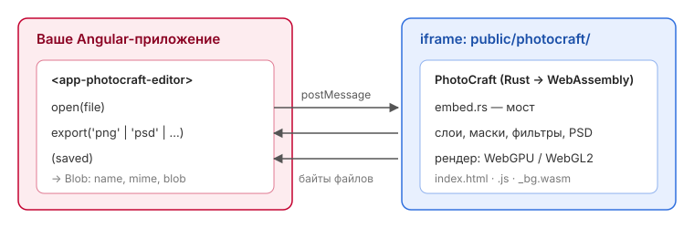

# PhotoCraft × Angular

Редактор изображений [PhotoCraft](https://github.com/storytold/photocraft) (открытый аналог Photoshop
на Rust → WebAssembly), встроенный в Angular-приложение. Angular открывает в редакторе картинки и PSD
и получает результат обратно в виде файла (`Blob`): PNG, JPEG, WebP, TIFF или PSD со слоями.



## Быстрый старт

Нужен только Node.js (Rust не нужен — готовая сборка редактора уже в репозитории).

```bash
git clone <адрес-этого-репозитория>
cd <папка>/angular
npm install
npm start
```

Откройте http://localhost:4200 → «Открыть пример» (или свой файл) → отредактируйте →
«Забрать PNG / JPEG / PSD» либо **File › Save** внутри редактора. Файлы появятся справа.

## Что где лежит

```
.
├── angular/                         Angular-приложение (демо)
│   ├── public/photocraft/           готовая сборка редактора (index.html + .js + .wasm)
│   ├── src/app/photocraft/          компонент <app-photocraft-editor> и типы сообщений
│   ├── src/app/app.*                демо-страница
│   └── scripts/build-photocraft.*   пересборка редактора → public/photocraft
├── photocraft/                      исходники PhotoCraft (Rust) с мостом для встраивания
│   └── apps/photocraft-web/src/embed.rs   мост: postMessage между редактором и страницей
├── patches/photocraft-embed.patch   мост одним патчем — для переноса на новую версию PhotoCraft
├── docs/INTEGRATION.md              подробная инструкция
└── .github/workflows/               CI: проверка Angular, пересборка редактора
```

## Встроить в свой Angular-проект

Коротко: скопировать `angular/public/photocraft/` → `public/photocraft/` и два файла из
`angular/src/app/photocraft/` → `src/app/photocraft/`, затем:

```html
<app-photocraft-editor #editor style="height: 80vh" (saved)="onSaved($event)" />
```
```ts
editor.open(file);                        // открыть картинку / PSD
const png = await editor.export('png');   // забрать результат: { name, mime, blob }
```

Пошагово, со сценариями, выкладкой на сервер и решением проблем — **[docs/INTEGRATION.md](docs/INTEGRATION.md)**.

## Пересборка редактора

Нужна только при изменении кода в `photocraft/`. Один раз установить
[Rust](https://rustup.rs) (1.95+), затем:

```bash
rustup target add wasm32-unknown-unknown
cargo install trunk --locked
cd angular
npm run photocraft:build        # Windows; на macOS/Linux — npm run photocraft:build:sh
```

## CI (GitHub Actions)

- **angular** — на каждый пуш и PR: `npm ci`, тесты, production-сборка.
- **editor** — при изменениях в `photocraft/` (или вручную): собирает редактор в WebAssembly и
  выкладывает архив `photocraft-embed-kit` (сборка + компонент + инструкция). На теге `v*`
  архив прикрепляется к GitHub Release.

## Происхождение и лицензии

- `photocraft/` — копия [storytold/photocraft](https://github.com/storytold/photocraft), коммит
  `24d10c3` (8 октября 2026), плюс мост для встраивания (`apps/photocraft-web/src/embed.rs` и
  небольшие правки рядом, см. `patches/`). Лицензия PhotoCraft — MIT или Apache-2.0 на выбор,
  тексты лицензий и `NOTICE` лежат в `photocraft/`; их нужно сохранять при распространении,
  в том числе вместе с готовой сборкой.
- PhotoCraft — ранняя альфа: возможны ошибки.
